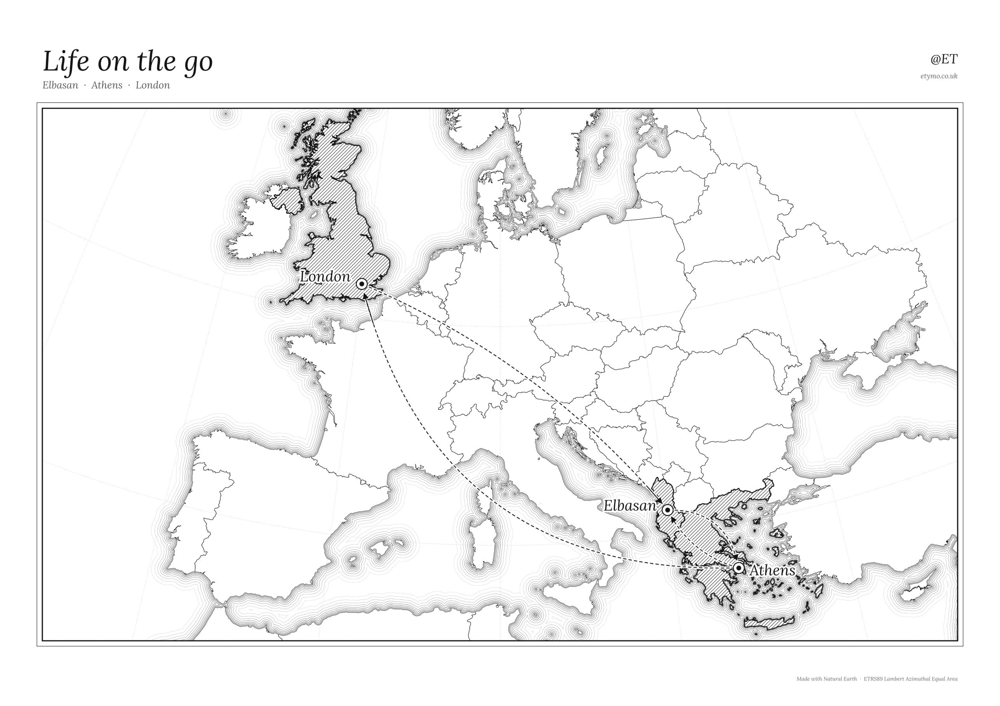
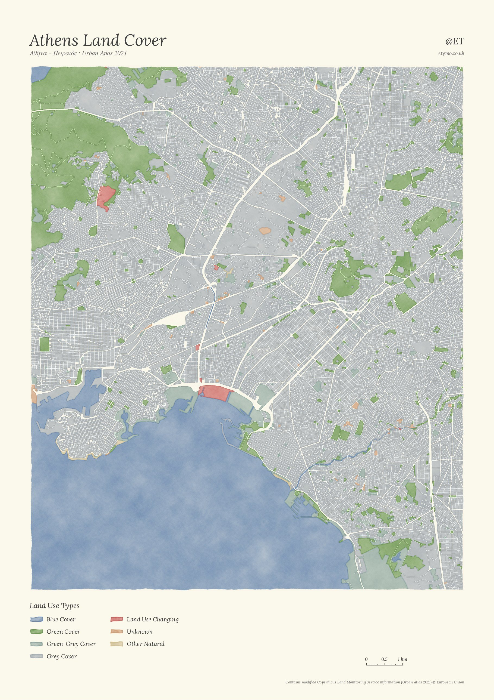
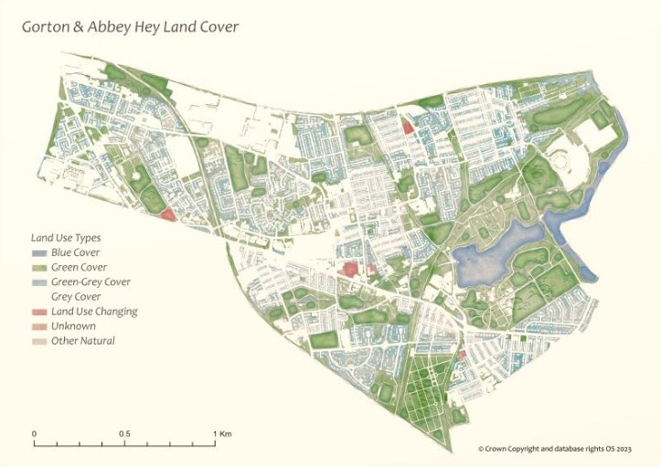
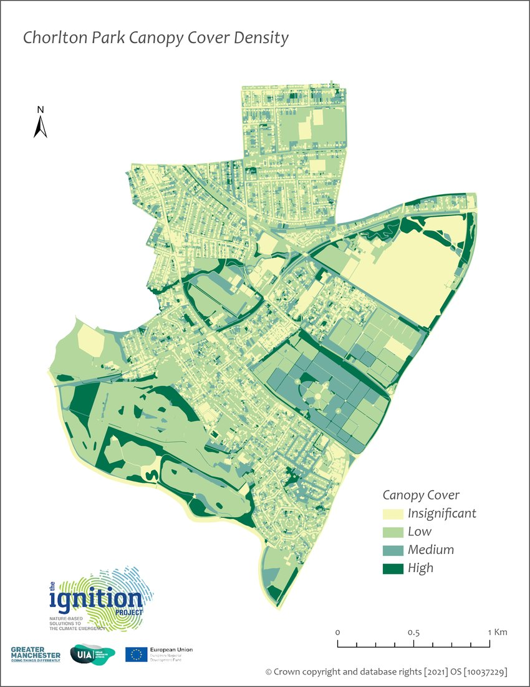
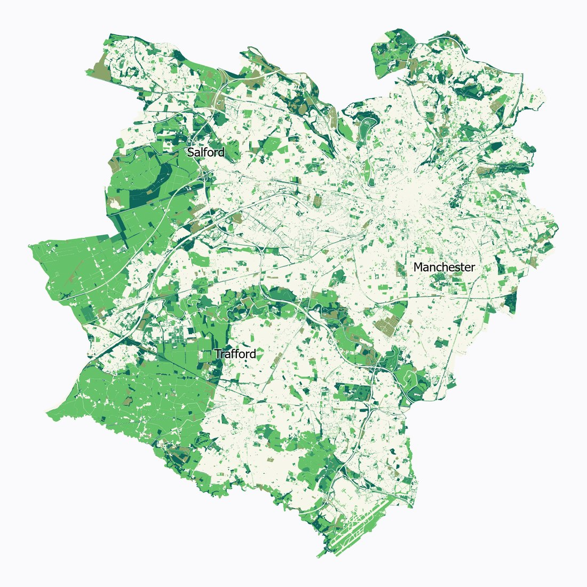
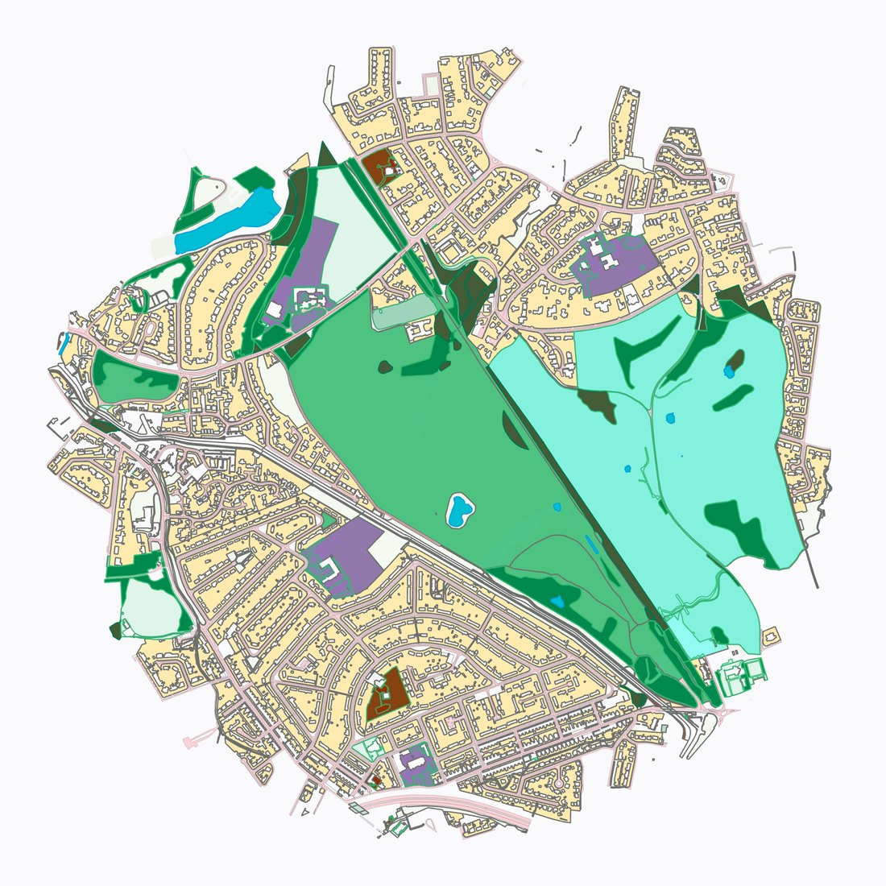
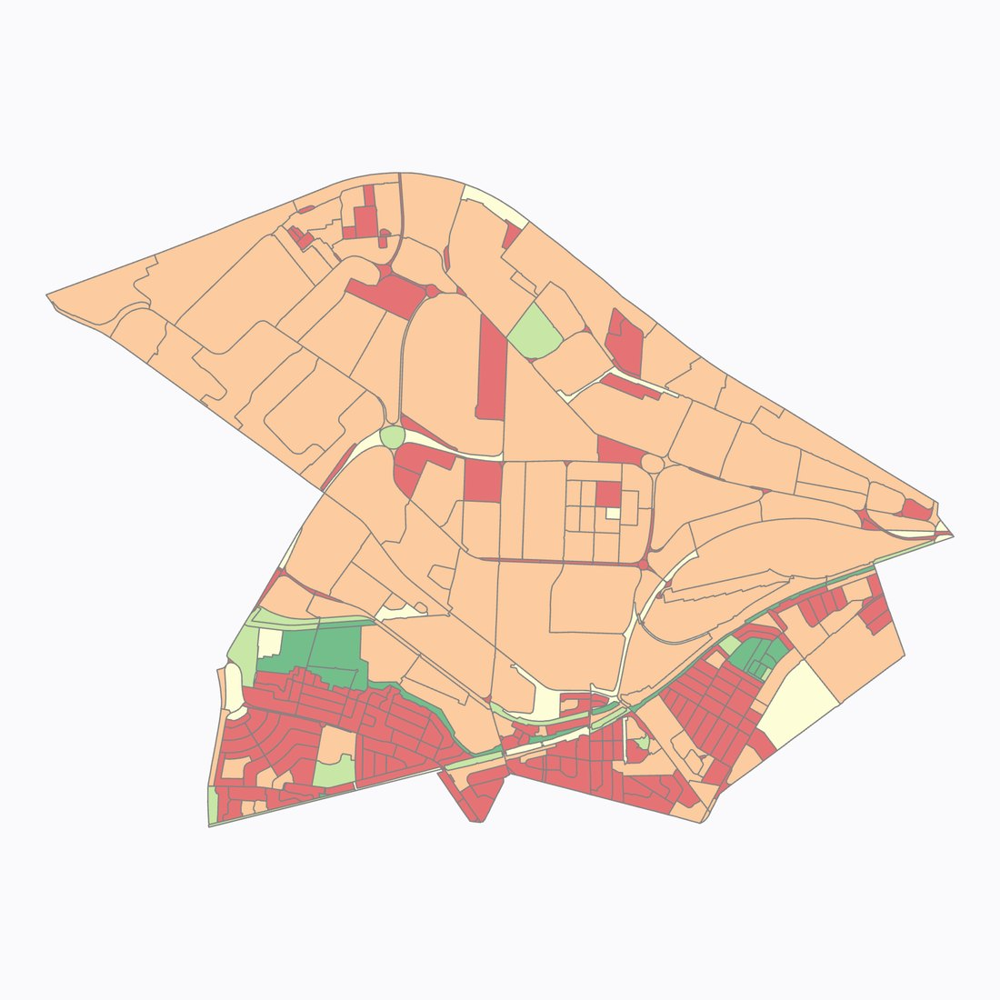

::: {.lead-intro}
Not every map has to answer a question. These are the ones I make because I like how they look, mostly on weekends, often after a week of checking numbers. I'll be adding more over time.
:::

::: {.featured-map}

Latest

{group="featured" fig-alt="Black and white map of Europe with Albania, Greece and the UK hatched, and dashed arrows linking Elbasan, Athens and London"}
:::

## In colour

### Watercolour cities (2026)

In 2022 I made a land cover map of Gorton and Abbey Hey in Manchester, styled with John Nelson's watercolour approach in ArcGIS Pro. Years later I recreated the look outside Pro, in Python, starting with Elbasan, Albania, where I'm from, and then Athens. Both use the Copernicus Urban Atlas 2021, reclassified into the same blue, green and grey legend I used in the IGNITION project.

::: {layout-ncol=2}
{group="colour" fig-alt="Watercolour land cover map of Elbasan, Albania"}

{group="colour" fig-alt="Watercolour land cover map of Athens and Piraeus"}
:::

Urban Atlas maps land *use*, not land cover, so there are judgement calls: Krasta, a wooded hill, has the same code as a small town park.

### Earlier work in Greater Manchester (2021–2023)

::: {.callout-note appearance="simple"}
**Shown as examples of my work only.** These maps were made for the IGNITION project and Greater Manchester partners and contain Ordnance Survey data © Crown copyright and database rights. They are shown here at low resolution and are not for reuse, reproduction or any decision-making.
:::

::: {layout-ncol=3}
{group="manchester"}

{group="manchester"}

{group="manchester"}

{group="manchester"}

{group="manchester"}
:::

## Black and white

*Life on the go*, at the top of this page, is the first in a black and white series. More are on the way.

---

*More maps soon. Prints are available: see the [About](../about.qmd) page to get in touch.*
