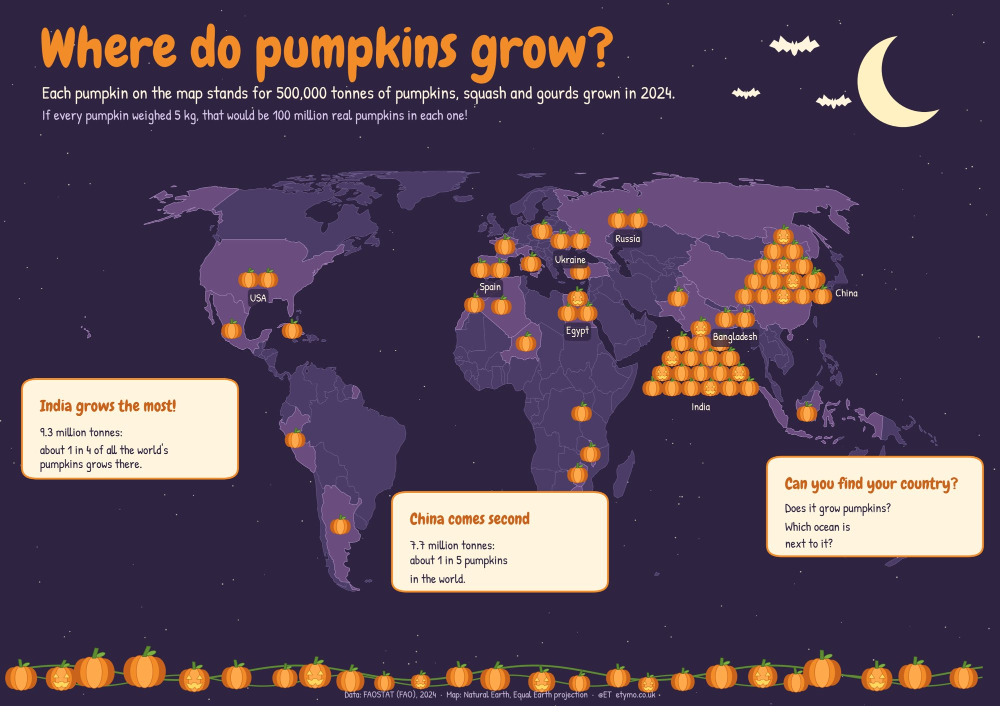
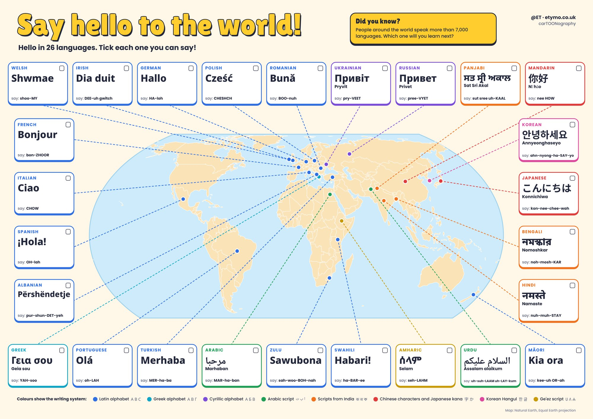
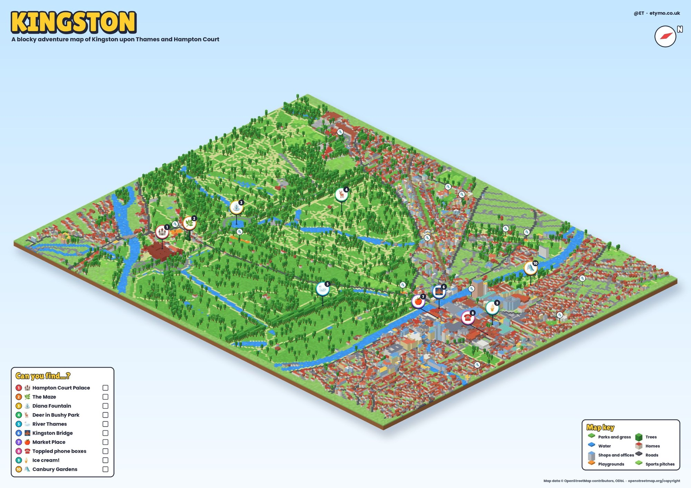

::: {.lead-intro}
Each map has a game hidden in it, from counting pumpkins to collecting places in a 3D world. They're the little sisters of my [cARTography](../cartography/) maps, and more are on the way.
:::

## Where do pumpkins grow?

A Halloween map of the world, with one pumpkin for every 500,000 tonnes grown in a year. Most of them are in India and China, but can you find the single pumpkins hiding in Peru, Malawi and Cuba?

{group="kids" fig-alt="A night-time world map with piles of cartoon pumpkins on the countries that grow the most, the biggest piles on India and China"}

<a href="downloads/where-do-pumpkins-grow-A3.pdf">Download the A3 print (PDF)</a>

## Say hello to the world!

Hello in 26 languages, from Bonjour to こんにちは, made to get kids excited about learning languages. The colours show the writing system, so you can spot which hellos share an alphabet. Tick each one you can say!

{group="kids" fig-alt="A world map with 26 cards around it, each saying hello in a different language and script, joined by lines to where the language is spoken"}

<a href="hello/" class="btn-play">🎮 Play the hello game</a> &nbsp; <a href="downloads/say-hello-to-the-world-A3.pdf">Download the A3 print (PDF)</a>

In the game you tap a dot to hear hello, say it out loud and collect a stamp in your passport. Then try the quiz: can you find where people say *Merhaba*?

## Kingston, in blocks

A blocky adventure map of Kingston upon Thames, Bushy Park and Hampton Court, built from OpenStreetMap. Find all ten places on the list: the palace, the maze, the deer, the toppled phone boxes and, of course, the ice cream.

{group="kids" fig-alt="A blocky 3D map of Kingston upon Thames and Bushy Park with numbered pins and a Can you find checklist"}

<a href="kingston/" class="btn-play">🎮 Play the 3D map</a> &nbsp; <a href="downloads/kingston-blocky-map-A2.pdf">Download the A2 print (PDF)</a>

In the 3D version you can spin the world, zoom in, and tap the floating icons to collect all ten. Each one has a fact to discover, and there's confetti when you find them all. It works on phones and tablets too.

---

*Would you like a themed map of your own town, school or favourite park? See the [About](../about.qmd) page to get in touch.*
