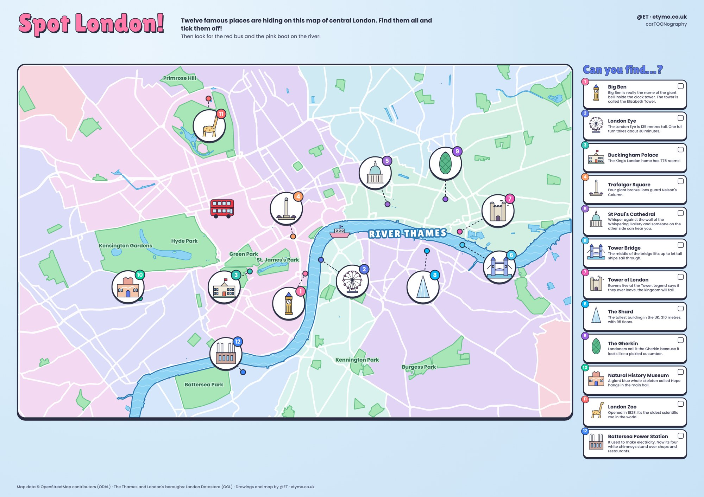
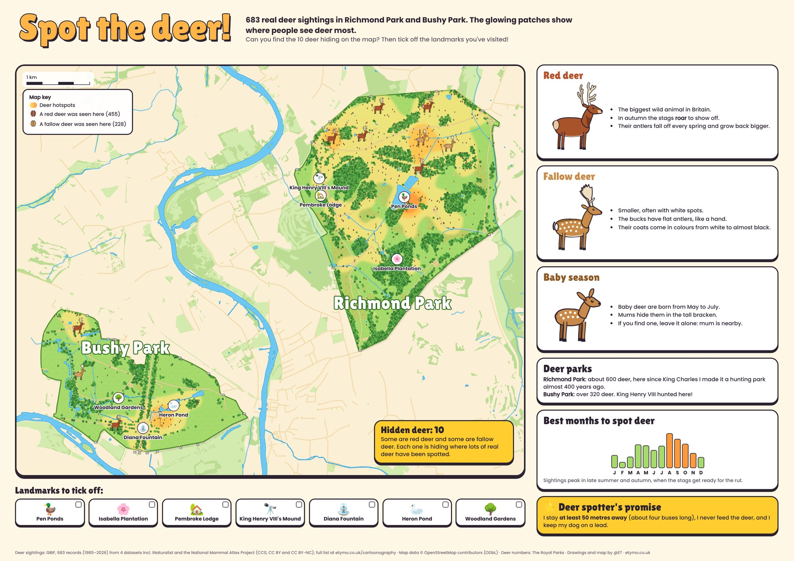
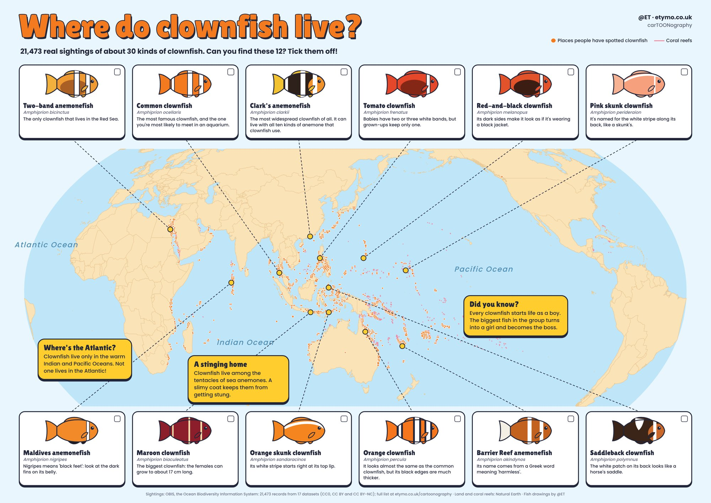
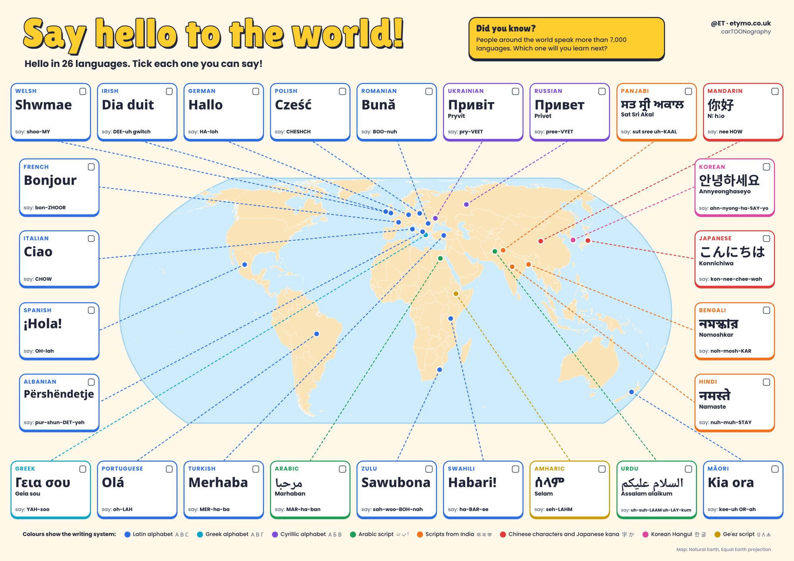
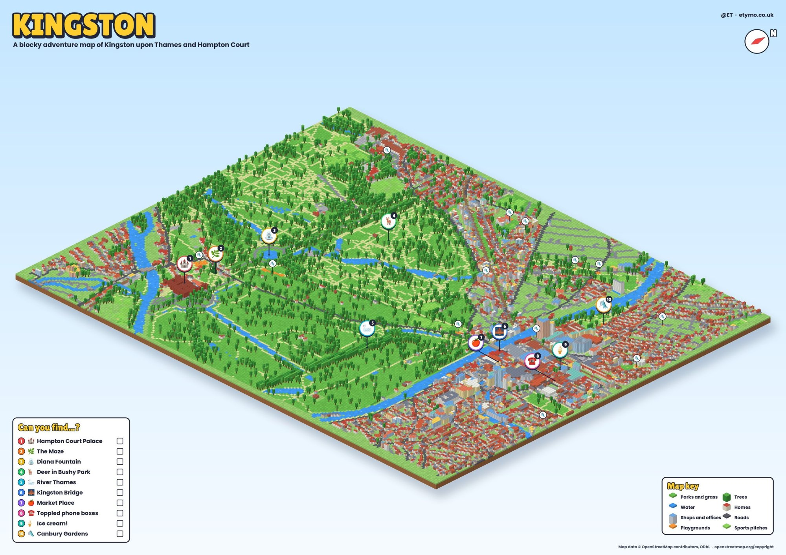
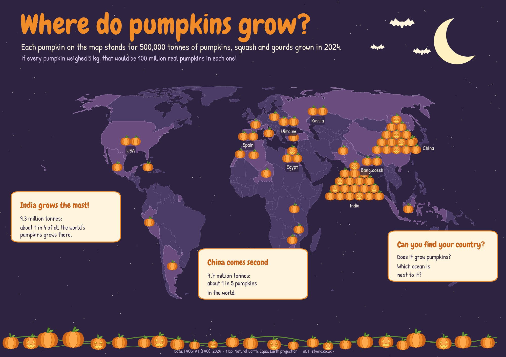

::: {.lead-intro}
Each map has a game hidden in it, from exploring London and spotting deer to hunting for clownfish to collecting hellos and finding places in a 3D Kingston. They're the little sisters of my [cARTography](../cartography/) maps, and more are on the way.
:::

## Spot London!

A colourful map of central London with twelve famous places to find, from Big Ben and the London Eye to Tower Bridge and the Gherkin. Each one has a fun fact, and there's a red bus and a pink boat hiding on the map too.

{group="kids" fig-alt="A pastel map of central London with the Thames in blue, green parks, and twelve cartoon landmarks in numbered circles, with a Can you find checklist"}

<a href="london/" class="btn-play">🎮 Play Spot London</a> &nbsp; <a href="downloads/spot-london-A3.pdf">Download the A3 print (PDF)</a>

In the game, the landmarks hide behind question marks. Kids tap each one to collect it in their London passport, then take the quiz: look at the picture and tap where that place really is.

## Spot the deer!

Richmond Park and Bushy Park are home to more than 900 red and fallow deer. This storybook map shows where people have really spotted them: the glowing patches are the deer hotspots, built from 683 sightings shared on iNaturalist and with the National Mammal Atlas Project. Ten deer are hiding on the map. Can you find them all?

{group="kids" fig-alt="A colourful storybook map of Richmond Park and Bushy Park with cartoon trees, ponds, glowing deer hotspots and small deer drawings, next to cards about red deer, fallow deer and baby deer"}

<a href="deer/" class="btn-play">🦌 Play spot the deer</a> &nbsp; <a href="downloads/spot-the-deer-A3.pdf">Download the A3 print (PDF)</a>

In the game, kids zoom into the parks to spot the hidden deer and tick off landmarks in their spotter's notebook, switch the real sightings between seasons to see where deer go in autumn, and earn a deer spotter badge in the quiz. And remember: always stay at least 50 metres away from real deer. Sightings come from [GBIF](https://www.gbif.org), using only openly licensed records ([list of datasets](deer/credits.csv)).

## Where do clownfish live?

More than 21,000 real sightings of clownfish, mostly photos people shared on iNaturalist, show where these little fish live: only in the warm Indian and Pacific Oceans, never the Atlantic. Can you find all 12 kinds on the map and tick them off?

{group="kids" fig-alt="A world map centred on the Pacific with orange dots where clownfish have been spotted, around the Indian and Pacific Oceans, and twelve cards with drawings of different clownfish"}

<a href="clownfish/" class="btn-play">🐠 Play find the clownfish</a> &nbsp; <a href="downloads/where-do-clownfish-live-A3.pdf">Download the A3 print (PDF)</a>

In the game, kids hunt for 12 hidden clownfish to fill their fish book, then take the quiz: which ocean has no clownfish at all? The sightings come from [OBIS](https://obis.org), and only openly licensed records are used ([list of datasets](clownfish/credits.csv)).

## Say hello to the world!

Hello in 26 languages, from Bonjour to こんにちは, made to get kids excited about learning languages. The colours show the writing system, so you can spot which hellos share an alphabet. Tick each one you can say!

{group="kids" fig-alt="A world map with 26 cards around it, each saying hello in a different language and script, joined by lines to where the language is spoken"}

<a href="hello/" class="btn-play">🎮 Play the hello game</a> &nbsp; <a href="downloads/say-hello-to-the-world-A3.pdf">Download the A3 print (PDF)</a>

In the game you tap a dot to hear hello, say it out loud and collect a stamp in your passport. Then try the quiz: can you find where people say *Merhaba*?

## Kingston, in blocks

A blocky adventure map of Kingston upon Thames, Bushy Park and Hampton Court, built from OpenStreetMap. Find all ten places on the list: the palace, the maze, the deer, the toppled phone boxes and, of course, the ice cream.

{group="kids" fig-alt="A blocky 3D map of Kingston upon Thames and Bushy Park with numbered pins and a Can you find checklist"}

<a href="kingston/" class="btn-play">🎮 Play the 3D map</a> &nbsp; <a href="downloads/kingston-blocky-map-A2.pdf">Download the A2 print (PDF)</a>

In the 3D version you can spin the world, zoom in, and tap the floating icons to collect all ten. Each one has a fact to discover, and there's confetti when you find them all. It works on phones and tablets too.

## Seasonal maps

Maps for special days of the year. They come back each season, and more will join them.

### Halloween: where do pumpkins grow?

A Halloween map of the world, with one pumpkin for every 500,000 tonnes grown in a year. Most of them are in India and China, but can you find the single pumpkins hiding in Peru, Malawi and Cuba?

{group="kids" fig-alt="A night-time world map with piles of cartoon pumpkins on the countries that grow the most, the biggest piles on India and China"}

<a href="downloads/where-do-pumpkins-grow-A3.pdf">Download the A3 print (PDF)</a>

---

*Would you like a themed map of your own town, school or favourite park? See the [About](../about.qmd) page to get in touch.*
