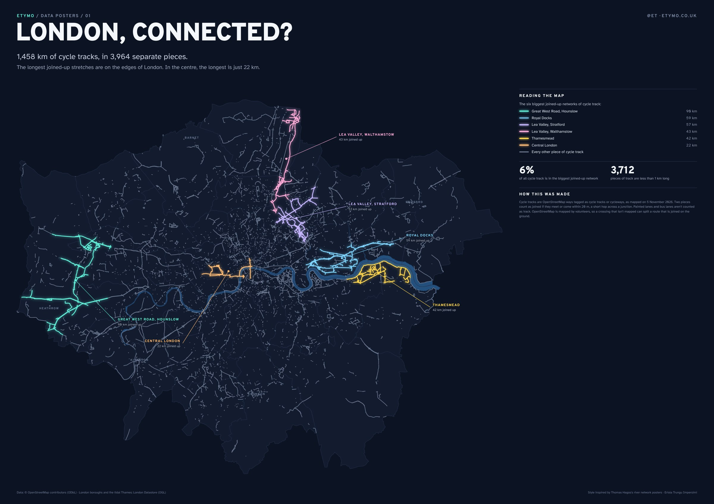
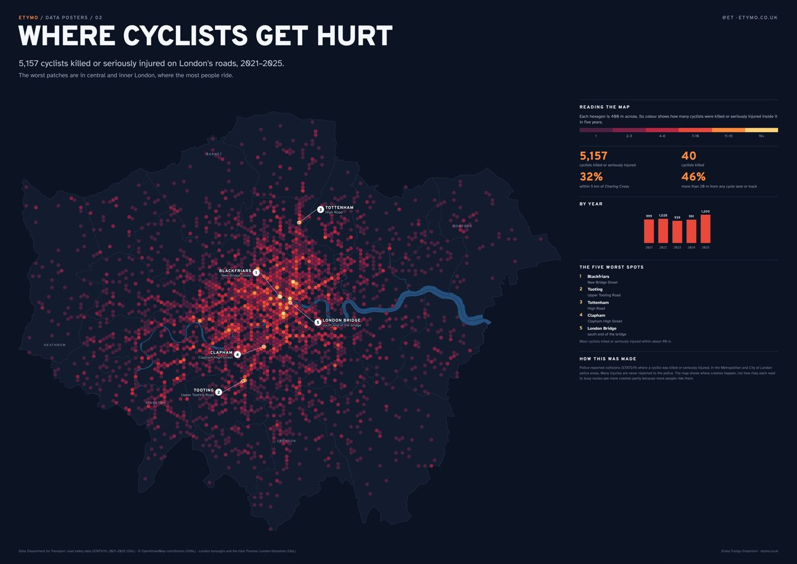

::: {.lead-intro}
I saw Thomas Hagos's posters of river networks and wanted to try something similar with London's cycle tracks. My first attempt had everything on one map, the tracks, the lanes and the collisions, and it was too busy to read. So I split it into two posters: one about how well the cycle tracks join up, and one about where cyclists get hurt. I'll be adding more posters on other topics.
:::

## 01 · London, connected?

London has 1,458 km of cycle tracks separated from traffic, but I wanted to know how much of it you can actually ride without leaving it. I joined up every piece of track that meets another, or comes within 20 m of it (a short hop across a junction), and ended up with 3,964 separate networks. The biggest one is 90 km, along the Great West Road near Heathrow, and that is only 6% of all the track. The other long ones are also on the edges of London: the Royal Docks, the Lea Valley and Thamesmead. In central London the longest is 22 km, from Hyde Park to Farringdon. 3,712 of the pieces are shorter than 1 km.

{group="posters" fig-alt="Dark poster of Greater London with cycle tracks drawn as thin lines; six large joined-up networks glow in colour on the edges of London, while central London is a scatter of short grey fragments"}

<a href="downloads/london-connected-A2.pdf">Download the A2 poster (PDF)</a>

## 02 · Where cyclists get hurt

Between 2021 and 2025, 5,157 cyclists were killed or seriously injured on London's roads, and 40 of them died. I counted them in 400 m hexagons. The highest numbers are in central and inner London, around Blackfriars and London Bridge, and on busy high streets like Upper Tooting Road, Clapham High Street and Tottenham High Road. 46% of these cyclists were hurt more than 20 m from any cycle lane or track.

{group="posters" fig-alt="Dark poster of Greater London covered in hexagons from dark red to bright yellow; the brightest are in central London, with five numbered hotspots"}

<a href="downloads/where-cyclists-get-hurt-A2.pdf">Download the A2 poster (PDF)</a>

## Reading them together

Looking at the two posters side by side, the long joined-up tracks are mostly on the edges of London, where there are fewer serious injuries, while the centre has short pieces of track and the most injuries. I can't say from this that the tracks are the reason. More people cycle in central London, so more people get hurt there, and there isn't open data on how many people cycle on every street to account for that. What I can say is that the places where most people cycle are the ones with the least joined-up track.

::: {.callout-note appearance="simple"}
**How these were made.** Cycle tracks are OpenStreetMap ways tagged as cycle tracks or cycleways, downloaded on 5 November 2026; painted lanes and bus lanes aren't counted as track. OpenStreetMap is mapped by volunteers, so a crossing that isn't mapped can split a route that is joined on the ground. Collisions are police-reported (STATS19) in the Metropolitan and City of London police areas, 2021–2025; many injuries are never reported to the police. The style is inspired by Thomas Hagos's river network posters.
:::

---

*If you would like a print, or a poster like this with your own data, you can find my email on the [About](../about.qmd) page.*
