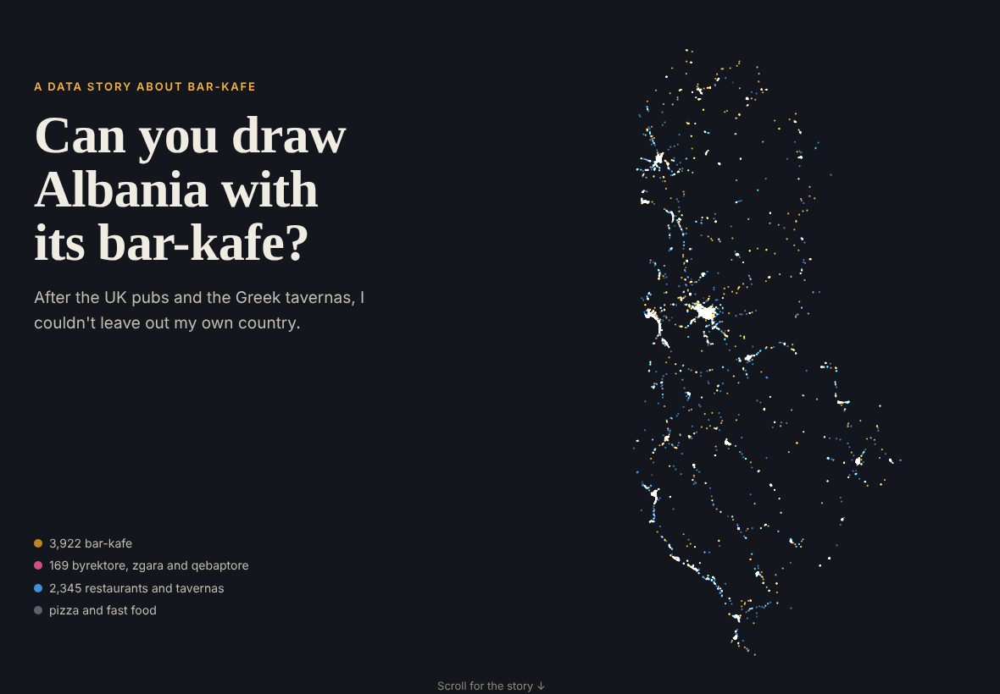
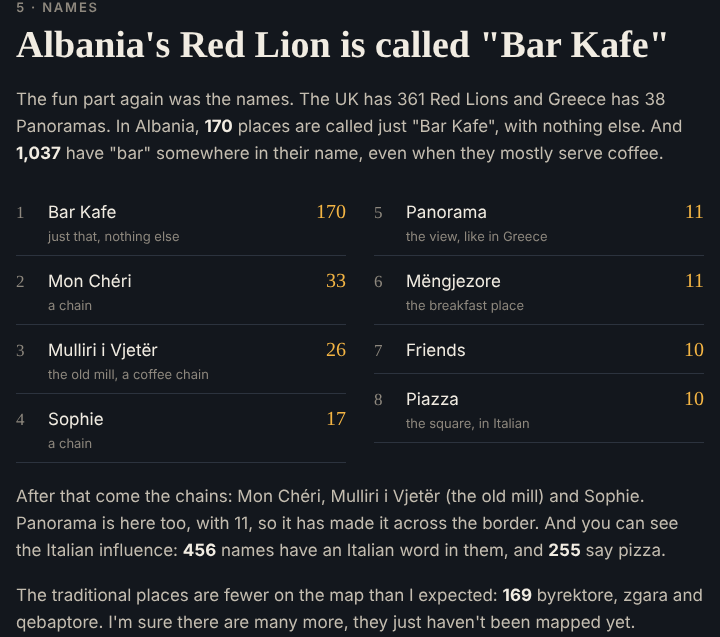

After [the UK pubs](../2026-10-uk-pubs/) and [the Greek tavernas](../2026-10-greek-tavernas/), I couldn't leave out Albania, my country of origin. In the UK it's the pub, in Greece the taverna, and in Albania it can only be the bar-kafe. There's one on every corner, and it's where people meet, talk and spend hours over one coffee.

## The map

I used OpenStreetMap again. This time the download worked first time, with 7,472 cafés, bars, restaurants and fast food places. I sorted them into bar-kafe (3,922), restaurants (2,345), the traditional byrektore, zgara and qebaptore (169) and pizza and fast food. Tirana, the coast and Shkodër light up the most.

## The data

INSTAT was easy to reach, and its tables download straight away. The problem is what's in them. Cafés, bars and restaurants are always counted together with hotels, and the last time they were counted by county was the 2010 enterprise census. Nationally, the number of businesses in accommodation and food fell from 20,043 in 2016 to 16,216 in 2021, then started to recover after COVID.

When I compared OpenStreetMap with the 2010 count, I found that Shkodër and Kukës have more places on the map today than were counted in 2010, while Tirana has only 38%. So someone has mapped the north very carefully.

## The names

The fun part again was the names. The UK has 361 Red Lions and Greece has 38 Panoramas. In Albania, 170 places are called just "Bar Kafe", with nothing else. After that come the chains, Mon Chéri, Mulliri i Vjetër and Sophie, and Panorama made it across the border too. You can also see the Italian influence, with 456 names that have an Italian word in them.

## Try it

- **The story and map:** [etymo.co.uk/albania-kafe](https://etymo.co.uk/albania-kafe/)
- **Code:** [github.com/eritrouib/albania-kafe](https://github.com/eritrouib/albania-kafe)

I made it with OpenStreetMap and INSTAT data, Python and Leaflet, coding with Claude.

---

*Data: © OpenStreetMap contributors (ODbL); INSTAT Structural Business Statistics, Business Registers, 2010 Economic Enterprises Census and population estimates.*
