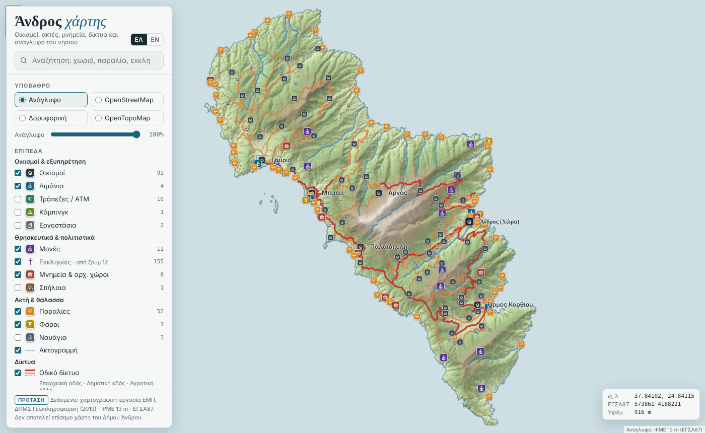

Back in 2019, during my MSc in Geoinformatics, I made a set of maps of Andros. I collected the base data from free online sources, created the digital terrain models myself and designed two printed maps at 1:150,000, one with contours and one with hypsometric tints and hillshading. I also made a web version, served through GeoServer with OpenLayers on top.

It worked well for the course. But it needed a map server running all the time, a styling file for every layer and someone to look after it. That's not something a small island can realistically keep going.

## What was missing

Before starting, I had a look at what's already out there. The Municipality of Andros publishes its maps as static images. The best interactive maps of the island come from others: [Andros Routes](https://www.androsroutes.gr/), a non-profit, looks after the trail network, and there are hiking maps you can buy. What I couldn't find was a simple, free map of the whole island that also gives coordinates in the Greek Grid (ΕΓΣΑ87), the system local engineers work with.

## The map

The new version is one web page, with no server behind it:

- **Relief first.** The 13 m terrain model and the hillshade are blended into one relief image, so you can read the shape of the island straight away.
- **Names that suit the zoom.** The generalised 1:150,000 settlements from 2019 decide which village names you see when you zoom out, so that work is still being used.
- **Click anywhere** to get the elevation and the coordinates in both WGS84 and ΕΓΣΑ87.
- **Draw a route** to get its length, ascent, descent and an elevation profile.
- **Greek and English**, with a search that doesn't mind accents, and its own symbol for every kind of feature.
- **OpenStreetMap layers** you can switch on for everyday use: health centres, pharmacies, police and fire stations, municipal offices, fuel, bus stops, springs, viewpoints and the waymarked trails. Each trail opens its own elevation profile.

## How I built it

I rebuilt it in Python, coding with Claude: GeoPandas for the vector layers, rasterio for the terrain and Leaflet for the map.

## What's next

I'd like to explore how a map like this could be useful in a council setting, for example for the Municipality of Andros, where a single file can sit inside their existing website with one line of code.

**Map:** [etymo.co.uk/AndrosWebMap](https://etymo.co.uk/AndrosWebMap/)
