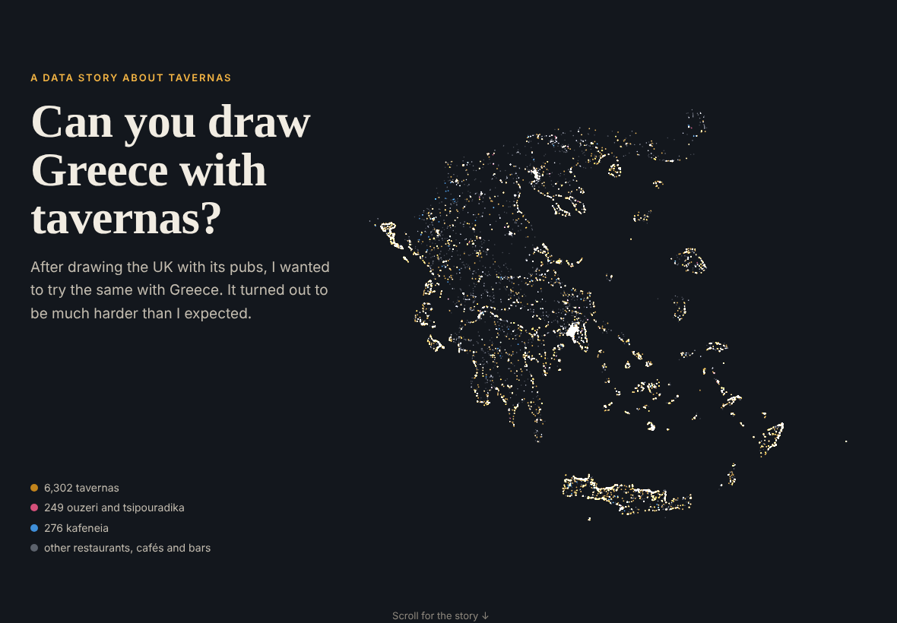
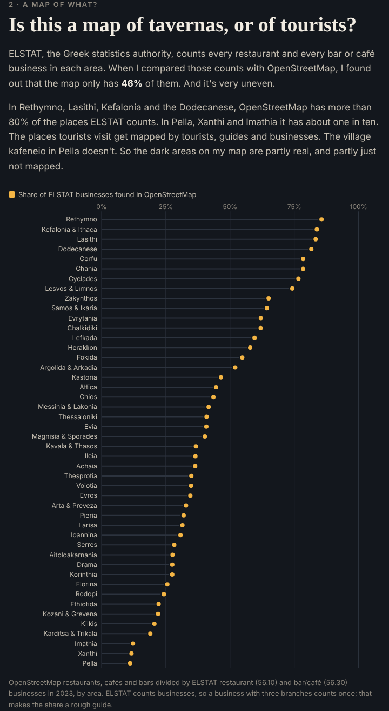

After [drawing the UK with its pubs](../2026-10-uk-pubs/), I wanted to try the same with Greece. The closest thing to a pub is probably the kafeneio, but for a map I thought tavernas, kafeneia and ouzeri together would work best.

It turned out to be much harder than I expected.

## Finding the data

For the UK I downloaded one register from one website, and every pub had a name, an address and coordinates. Greece doesn't have anything like it. The food authority and the health ministry only publish summary tables of their inspections. On data.gov.gr I found only a handful of municipalities, out of 332, that publish their list of licensed shops, and some of those are PDFs or stop in 2018.

So I used OpenStreetMap. Even that wasn't easy: the servers refused my downloads, so I had to download it by hand in the browser, and it crashed my computer. In the end I had 33,951 restaurants, cafés and bars, and I sorted them into tavernas, kafeneia and ouzeri using their names and tags.

## A map of tavernas, or of tourists?

The islands and the coast light up, and much of the north is dark. Then I compared the map with ELSTAT's official counts of restaurants, bars and cafés, and found out that OpenStreetMap has only 46% of them. On Crete and the islands it has more than 80%, but in Pella, Xanthi and Imathia only about one in ten. So the map shows where tourists go as much as where the tavernas are.

## The crisis and the names

ELSTAT's numbers show about 15% fewer bars, cafés and restaurants since 2011, but twice as many people working in bars and cafés. It's the same as the UK pubs: fewer places, but bigger ones. Attica gained bars and cafés from 2016 to 2023, while the north lost about a quarter.

The fun part was the names again. Greece doesn't have a Red Lion. The most common name is Panorama, with only 38, followed by Akrogiali (the seashore), Nikos and, of course, Zorbas.

## Try it

- **The story and map:** [etymo.co.uk/greek-tavernas](https://etymo.co.uk/greek-tavernas/)
- **Code:** [github.com/eritrouib/greek-tavernas](https://github.com/eritrouib/greek-tavernas)

I made it with OpenStreetMap and ELSTAT data, Python and Leaflet, coding with Claude.

---

*Data: © OpenStreetMap contributors (ODbL); ELSTAT Statistical Business Register and population estimates.*
