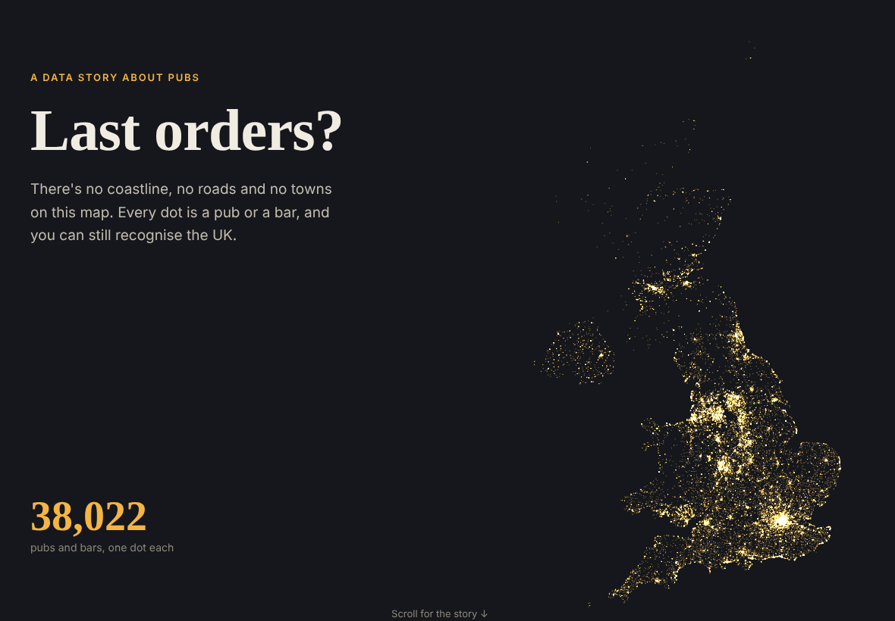
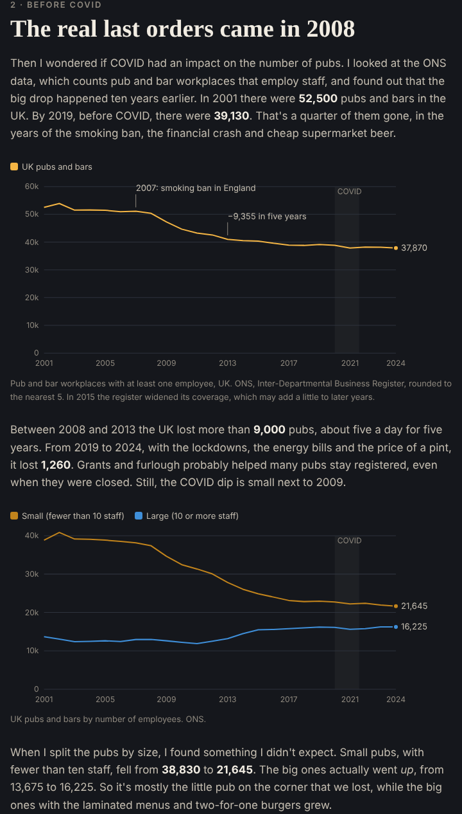

Can you draw the UK using only pubs? I wanted to find out.

I downloaded the Food Standards Agency food hygiene register, which lists every place that serves food or drink. I picked out all the pubs and bars, 38,022 of them, and visualised them as dots. I didn't add any coastline, roads or towns, just the pubs, and you can still recognise the whole country.

## Did COVID close the pubs?

Then I wondered if COVID had an impact. I looked at the ONS data, which counts pubs and bars with staff, and found out that the big drop happened ten years earlier. The UK lost more than 9,000 pubs between 2008 and 2013, and 1,260 between 2019 and 2024. When I split them by size, it was mostly the small pubs that closed (down 44%), while the big ones actually grew.

## The fun part

The fun part was going through the pub names. There are 361 Red Lions, and there are more animals than royals in pub names. I also looked for the streets with the most pubs (Swansea's Wind Street has 13 bars in 186 metres) and the place furthest from a pub, which in England is 15.7 km away, in Kielder Forest.

You can also check how pubby your postcode is. Mine is "pub crawl territory".

## Try it

- **The story and map:** [etymo.co.uk/uk-pubs](https://etymo.co.uk/uk-pubs/)
- **Code:** [github.com/eritrouib/uk-pubs](https://github.com/eritrouib/uk-pubs)

I made it with open FSA and ONS data, Python and Leaflet, coding with Claude.

---

*Data: Food Standards Agency food hygiene rating data; ONS public houses and bars, and population estimates (Open Government Licence v3.0).*
